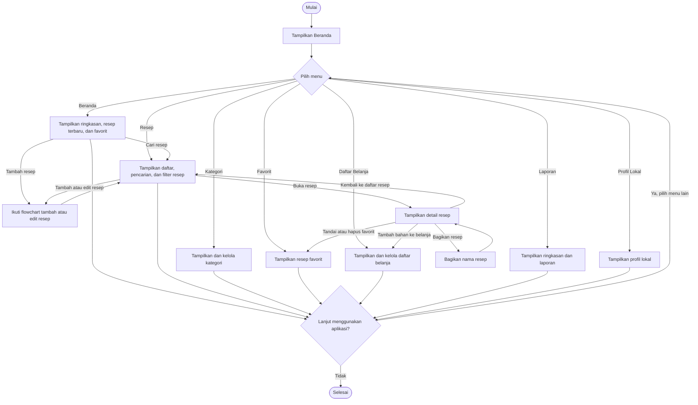
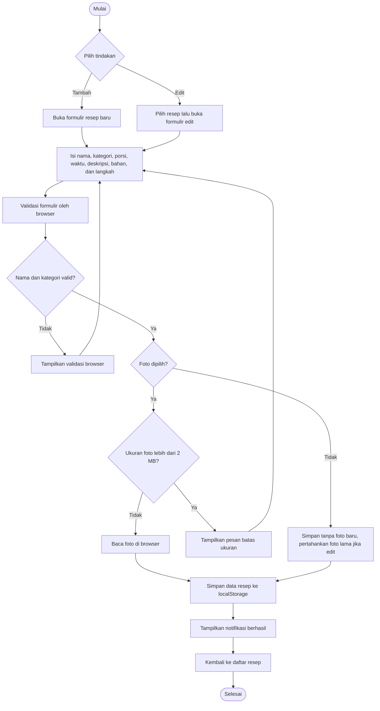

# Flowchart MASAKin

## Alur navigasi aplikasi

MASAKin langsung menampilkan Beranda tanpa proses login. Setelah melihat halaman
yang dipilih, pengguna dapat memilih menu lain atau meninggalkan aplikasi.

## Alur tambah atau edit resep

Form yang sama digunakan untuk menambah resep baru maupun mengedit resep yang
sudah ada. Nama resep dan kategori wajib diisi. Foto bersifat opsional dan
dibatasi maksimal 2 MB. Data disimpan di `localStorage` browser, bukan database
server, sehingga perubahan hanya tersedia di browser/perangkat tersebut.

